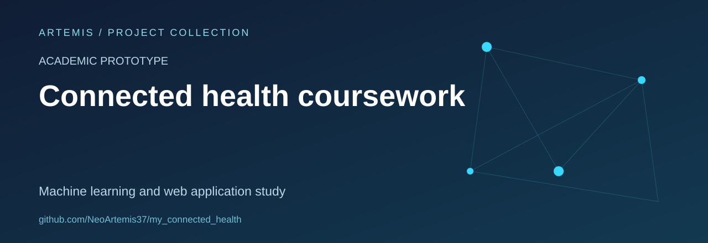

# DiagnoX Learning Prototype

An educational experiment combining a conversational web interface, symptom-related text processing and a Flask API.

**Status:** educational prototype. Clinical use, diagnosis and emergency support are outside its intended scope.

## What is in this snapshot

| Path | Contents |
| --- | --- |
| `backend/app.py` | Flask routes and application logic |
| `backend/models/` | Conversation, symptom-classification and history-analysis modules |
| `backend/generator.py` | Dataset-generation code |
| `frontend/index.html` | Browser interface |
| `data/` | Training material and dataset notes |
| `start.py` | Development startup helper |

The backend contains references to text processing, conversation storage and model-based analysis. Those references describe an experimental architecture, not verified medical performance.

## Completeness

The source includes `DiseasePredictor`, `ConversationalAgent` and `PredictiveHealthAnalyzer`, together with saved training artefacts. A dependency manifest and the referenced `.env.example` are not included. The configuration and end-to-end behaviour still need a documented, reproducible verification.

No clinical evaluation report or reproducible model-performance study is included in this snapshot.

## Development priorities

- Document the included modules and provide a complete dependency manifest.
- Establish dataset provenance and use synthetic data for demonstrations.
- Separate interface demonstrations from any medical decision-making claim.
- Define appropriate privacy controls before considering sensitive user data.

## Scope

This repository is a software and data-learning exercise. Its generated text and model outputs must not be treated as diagnosis or care instructions. No clinical validation, performance guarantee or production deployment is claimed.

No repository-wide licence file is currently included.
